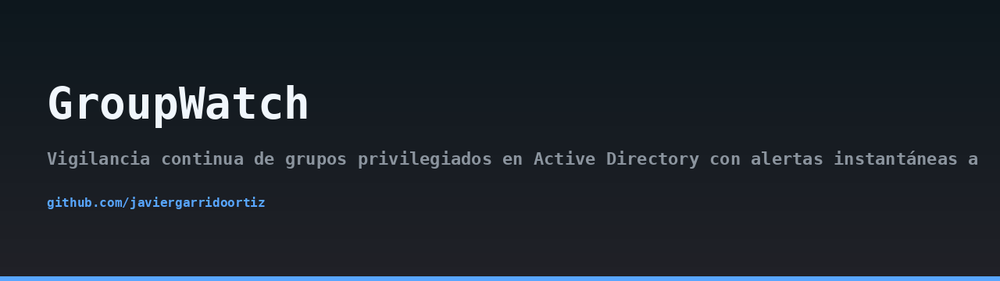
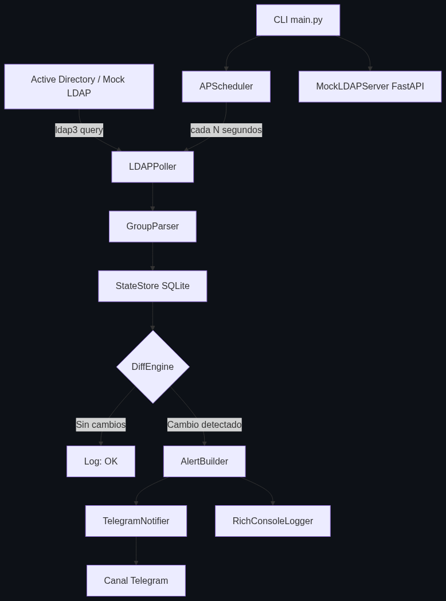
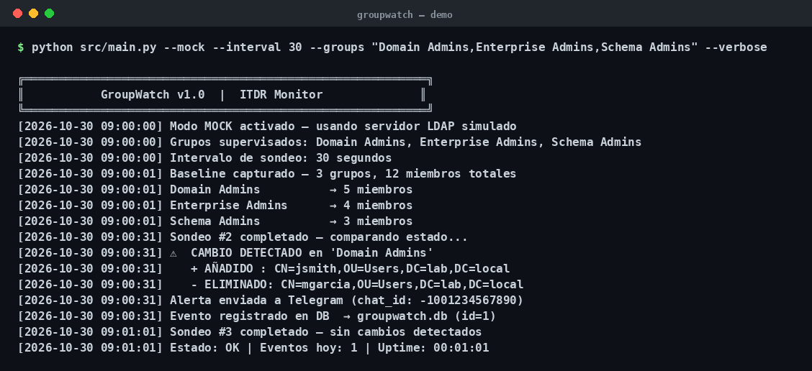
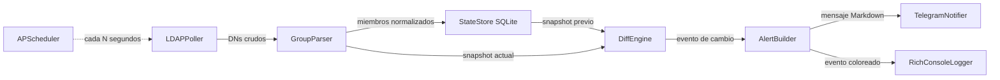

## Arquitectura



## Demo



> 🇬🇧 Read this in [English](README.en.md).

# GroupWatch


GroupWatch es una herramienta de vigilancia continua para grupos privilegiados de Active Directory. Sondea periódicamente la composición de grupos como `Domain Admins`, `Enterprise Admins` o `Schema Admins`, detecta altas y bajas de miembros en tiempo casi real y envía alertas instantáneas a un chat de Telegram. Está diseñada para equipos defensivos que necesitan visibilidad inmediata sobre cambios de identidad en su bosque AD.

## Descripción del problema

En la mayoría de incidentes de ransomware y ataques de movimiento lateral, el adversario intenta escalar privilegios añadiendo cuentas a grupos de alto valor. Un atacante que consigue meter una cuenta controlada en `Domain Admins` obtiene control efectivo del dominio en cuestión de minutos. Los mecanismos nativos de auditoría de Windows (Event ID 4728, 4732, 4756) requieren que alguien esté mirando los logs o que exista una regla SIEM bien afinada, algo que muchas organizaciones pequeñas y medianas no tienen.

GroupWatch cubre ese hueco desde la perspectiva de ITDR (Identity Threat Detection and Response):

- Detecta cambios de composición en grupos críticos sin depender de un SIEM.
- Mantiene un baseline persistente en SQLite para comparar contra el estado previo.
- Alerta por un canal de baja fricción (Telegram) que el equipo de guardia consulta en el móvil.
- Funciona en modo `--mock` para que puedas probar el flujo completo sin tocar un AD real.

La ventana de exposición entre el momento en que un atacante añade una cuenta a un grupo privilegiado y el momento en que tú te enteras es el factor que más influye en el impacto del incidente. GroupWatch reduce esa ventana a un intervalo configurable (por defecto, 60 segundos).

## Arquitectura

GroupWatch sigue un pipeline de sondeo continuo dividido en cinco capas desacopladas:

1. **Adquisición** (`src/ldap_poller.py`): usa `ldap3` para consultar los miembros actuales de cada grupo configurado. En modo mock arranca `src/mock_server.py`, un servidor FastAPI que devuelve respuestas LDAP-like en JSON.
2. **Parsing** (`src/group_parser.py`): normaliza los DN devueltos por LDAP en objetos Python con `cn`, `dn`, `samaccountname` y `timestamp`.
3. **Persistencia** (`src/state_store.py`): serializa el snapshot de cada grupo en SQLite (`groupwatch.db`). En el primer arranque genera el baseline; en arranques posteriores lo recupera.
4. **Comparación** (`src/diff_engine.py`): calcula el delta entre el snapshot previo y el actual, produciendo conjuntos `added` y `removed`. Si el delta está vacío no emite evento.
5. **Alertas** (`src/alert_builder.py` + `src/telegram_notifier.py`): formatea el evento como mensaje Markdown enriquecido y lo envía a Telegram. En paralelo, `RichConsoleLogger` imprime el evento coloreado en consola.

`APScheduler` orquesta el ciclo de sondeo como job en background cada `POLL_INTERVAL` segundos. El punto de entrada CLI (`src/main.py`) parsea argumentos con `argparse`, carga variables de entorno desde `.env` con `python-dotenv`, inicializa los módulos y arranca el scheduler en modo bloqueante.



## Requisitos

- Python 3.11 o superior.
- Una cuenta de Telegram con un bot creado mediante [@BotFather](https://t.me/BotFather) y el `chat_id` del grupo o canal destino.
- Acceso LDAP a un Active Directory (o usar el modo `--mock` para pruebas).
- Permisos de lectura sobre los grupos que quieras monitorizar.

## Instalación

1. Clona el repositorio:

   ```bash
   git clone https://github.com/javiergarrido/groupwatch.git
   cd groupwatch
   ```

2. Crea un entorno virtual e instala dependencias:

   ```bash
   python3.11 -m venv .venv
   source .venv/bin/activate
   pip install -r requirements.txt
   ```

3. Copia el fichero de ejemplo de configuración y rellénalo:

   ```bash
   cp .env.example .env
   ```

4. Edita `.env` con tus credenciales LDAP y de Telegram (ver sección Configuración).

5. Verifica que todo funciona en modo mock:

   ```bash
   python -m src.main --mock --verbose
   ```

## Configuración

Todas las variables sensibles se cargan desde `.env` mediante `python-dotenv`. Nunca se hardcodean credenciales en el código.

| Variable | Obligatoria | Descripción |
|---|---|---|
| `LDAP_HOST` | sí (modo real) | Hostname o IP del controlador de dominio. |
| `LDAP_PORT` | no | Puerto LDAP (por defecto `636` para LDAPS). |
| `LDAP_BIND_DN` | sí (modo real) | DN de la cuenta de servicio usada para el bind. |
| `LDAP_BIND_PASSWORD` | sí (modo real) | Contraseña de la cuenta de servicio. |
| `LDAP_BASE_DN` | sí (modo real) | Base DN del dominio, p. ej. `DC=corp,DC=local`. |
| `TELEGRAM_TOKEN` | sí | Token del bot obtenido vía BotFather. |
| `TELEGRAM_CHAT_ID` | sí | `chat_id` del grupo o canal destino de las alertas. |
| `GROUPS` | sí | Lista separada por comas de grupos a vigilar. |
| `POLL_INTERVAL` | no | Segundos entre sondeos (por defecto `60`). |

Ejemplo mínimo de `.env`:

```dotenv
LDAP_HOST=dc01.corp.local
LDAP_PORT=636
LDAP_BIND_DN=CN=svc-groupwatch,OU=Services,DC=corp,DC=local
LDAP_BIND_PASSWORD=cambia-esto
LDAP_BASE_DN=DC=corp,DC=local
TELEGRAM_TOKEN=123456:ABC-DEF...
TELEGRAM_CHAT_ID=-1001234567890
GROUPS=Domain Admins,Enterprise Admins,Schema Admins
POLL_INTERVAL=60
```

## Uso

Arrancar en modo mock (no requiere AD real, útil para desarrollo y demos):

```bash
python -m src.main --mock --verbose
```

Arrancar contra un AD real con la configuración del `.env`:

```bash
python -m src.main
```

Sobrescribir la lista de grupos en línea de comandos:

```bash
python -m src.main --groups "Domain Admins,Backup Operators"
```

Ejecutar un único ciclo de sondeo y salir (útil para cron o pruebas):

```bash
python -m src.main --once --verbose
```

Modo `--dry-run`: calcula el diff y muestra la alerta por consola pero no envía nada a Telegram:

```bash
python -m src.main --dry-run --verbose
```

Flags disponibles:

- `--mock`: arranca el servidor LDAP simulado en local.
- `--verbose`: logging detallado por consola con Rich.
- `--dry-run`: no envía alertas a Telegram.
- `--groups`: sobrescribe `GROUPS` del `.env`.
- `--once`: ejecuta un único ciclo y termina.
- `--interval`: sobrescribe `POLL_INTERVAL` en segundos.

## Ejemplo de alerta Telegram

Cuando se detecta un cambio, el mensaje llega al chat con este formato:

```text
🚨 GroupWatch — cambio en grupo privilegiado

Grupo: Domain Admins
Hora: 2025-03-14 09:42:11 UTC

➕ Añadidos:
  • CN=John Doe,OU=IT,DC=corp,DC=local (jdoe)

➖ Eliminados:
  • CN=Old Admin,OU=IT,DC=corp,DC=local (oadmin)

Total miembros actuales: 12
```

En el primer arranque no se envía alerta: se genera el baseline silenciosamente. A partir de ahí, cualquier alta o baja dispara notificación.

## Mapeo MITRE ATT&CK

GroupWatch ayuda a detectar técnicas concretas del marco MITRE ATT&CK relacionadas con manipulación de identidades:

- **T1098 — Account Manipulation**: el atacante modifica la pertenencia a grupos para escalar privilegios. GroupWatch detecta el alta no esperada de una cuenta en un grupo privilegiado.
- **T1078 — Valid Accounts**: uso de cuentas legítimas comprometidas. La combinación de una cuenta nueva en `Domain Admins` con actividad anómala encaja con esta técnica; GroupWatch aporta la señal de identidad que activa la investigación.

Estas señales son de contexto: no sustituyen a la correlación con logs de autenticación, pero sí cierran el hueco de visibilidad sobre cambios de composición de grupos.

## Limitaciones y consideraciones éticas

- GroupWatch **solo debe usarse en entornos propios o con autorización explícita por escrito** del propietario del dominio. El acceso no autorizado a un directorio activo es ilegal en la mayoría de jurisdicciones.
- La herramienta realiza binds LDAP de solo lectura. No modifica grupos ni cuentas. Aun así, revisa los permisos de la cuenta de servicio y aplícale el principio de mínimo privilegio.
- El baseline se guarda en SQLite local. Si borras `groupwatch.db`, el siguiente arranque generará un baseline nuevo y perderás el histórico de comparación.
- La detección depende de la frecuencia de sondeo. Un cambio que se produzca y se revierta entre dos sondeos no se detectará. Ajusta `POLL_INTERVAL` según tu tolerancia al riesgo.
- Telegram es un canal externo. No envíes información clasificada ni credenciales en los mensajes. GroupWatch solo envía `cn`, `samaccountname` y `dn`, pero revisa tu política de tratamiento de datos antes de desplegarlo.
- El modo `--mock` está pensado para desarrollo y formación. No lo uses como sustituto de pruebas contra un AD de laboratorio.
- GroupWatch no es un SIEM ni sustituye a uno. Es una capa adicional de detección de identidad.

## Licencia

Distribuido bajo licencia MIT. Consulta el fichero [LICENSE](LICENSE) para el texto completo.

Autor: Javier Garrido Ortiz.
